# 하루정리 (Haru Board)

할 일·메모, 가계부·예산, 매일 한자 한 글자와 퀴즈·주간 오답 복습, 하루 마무리 일기를 한곳에서 관리하는 개인용 반응형 웹 대시보드입니다.

- **배포 주소:** <https://haru-board-navy.vercel.app>
- **GitHub:** <https://github.com/nihao72-netizen/haru-board>
- **요구사항 문서:** [PRD.md](PRD.md) (v1.3 + 맨 아래 v1.4 추가 확정 규칙)

## 바로 사용해 보기 (평가자 안내)

### 샘플 확인 (가입 없이 보기 전용)

배포 주소 첫 화면이나 로그인 화면의 **「샘플 확인」**을 누르면, 약 두 달치 할 일·메모·가계부(예산 포함)와 한 달치 일기가 채워진 샘플 계정으로 바로 들어갑니다.

- **보기 전용**입니다. 모든 화면을 둘러볼 수 있지만, 추가·수정·삭제·완료 표시를 하면 "샘플 계정은 보기만 할 수 있어요" 안내가 나오고 저장되지 않습니다. 이 제한은 화면이 아니라 DB가 강제합니다(아래 '구조와 보안 설계').
- 화면 위 안내 띠의 **「내 계정 만들고 시작하기」**를 누르면 로그아웃 후 회원가입으로 이동합니다.
- 일기 본문을 열 때 묻는 비밀번호는 샘플에서는 미리 채워져 있습니다.
- 직접 로그인하려면: `aaa@aaa.com` / `dkssud` (같은 보기 전용 계정. 비밀번호·이메일도 바꿀 수 없음)

### 직접 가입해서 써 보기

1. 배포 주소에서 **회원가입**을 누르고 이메일·비밀번호(닉네임은 선택)를 입력합니다.
   - 평가 편의를 위해 **이메일 확인 절차 없이 바로 가입·로그인**됩니다. 실제로 받지 않는 이메일 주소를 써도 됩니다.
2. 가입하면 기본 분류가 자동으로 만들어집니다.
   - 기록 분류: 공부, 업무, 일상
   - 지출 분류: 식비, 교통, 쇼핑, 생활, 문화
   - 수입 분류: 급여, 부수입, 용돈
3. 아래 순서로 둘러보면 전체 흐름을 볼 수 있습니다.

| 순서 | 화면 | 해 볼 것 |
|---|---|---|
| 1 | 홈 `/` | 한 일·오늘 할 일·해야 될 일 세 칸 확인, 빠른 추가, 체크로 완료, 가계부·한자·일기 요약 카드 확인 |
| 2 | 할 일 `/todos` | '＋ 작업 추가'(또는 Q 키)에 `내일 오후 2시 보고서 점검 p1 #업무`처럼 입력 → 날짜·시각·우선순위·분류 칩 확인 후 Enter. 오늘 / 다음 / 캘린더 / 분류별 보기, 작업을 눌러 상세(설명·하위 작업·알림) 편집, 체크로 완료 → 토스트의 '실행 취소', 오른쪽 '완료한 일'에서 날짜별로 완료 기록 확인·완료 취소 |
| 3 | 가계부 `/ledger` | 수입·지출 입력('기타'로 새 분류 만들기), 일/주/월 이동과 합계 |
| 4 | 가계부 › 통계·예산 탭 | 월 전체 예산과 분류별 예산 설정, 사용률·경고, 월별·분류별 지출 그래프 |
| 5 | 한자 `/hanja` | '오늘의 한자 받기' → 학습 시작 → 학습 완료, 오늘의 퀴즈 풀기(반복 가능) |
| 6 | 하루 마무리 `/daily` | 날짜별 기록 모아 보기, 제목 있는 자유 일기 쓰기, 내 일기 목록에서 골라 비밀번호 확인 후 보기 |
| 7 | 내 계정 `/account` | 닉네임 변경, 로그아웃 |

> 월요일 오답 복습은 **지난주에 틀린 문제**로 만들어집니다. 새 계정은 지난주 기록이 없으므로 처음에는 "아직 복습 회차가 없습니다"로 보입니다. 개발 중에는 관리자용 테스트 시드로 검증했습니다(아래 '검증' 참고).

## 화면 미리보기

배포 사이트의 '샘플 확인'(보기 전용) 화면입니다. 그림을 누르면 크게 볼 수 있습니다.

<table>
<tr><td width="50%"><a href="docs/screenshots/01-landing.jpg">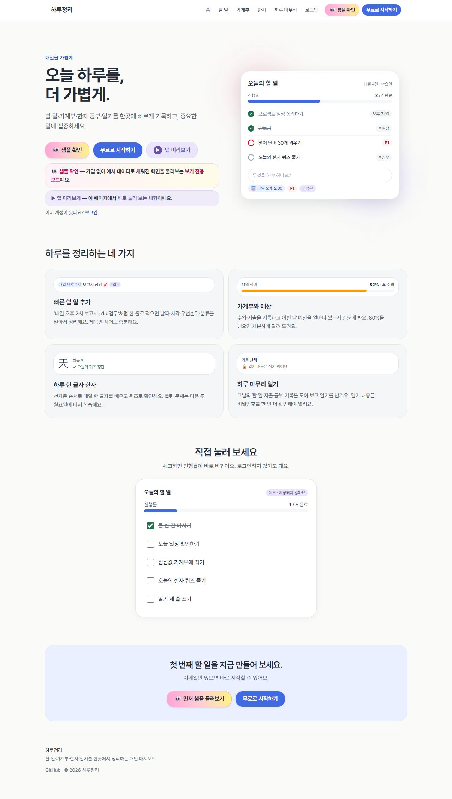</a><br><sub>로그인 전 소개 화면 — 샘플 확인·데모 목록</sub></td><td width="50%"><a href="docs/screenshots/02-home.jpg">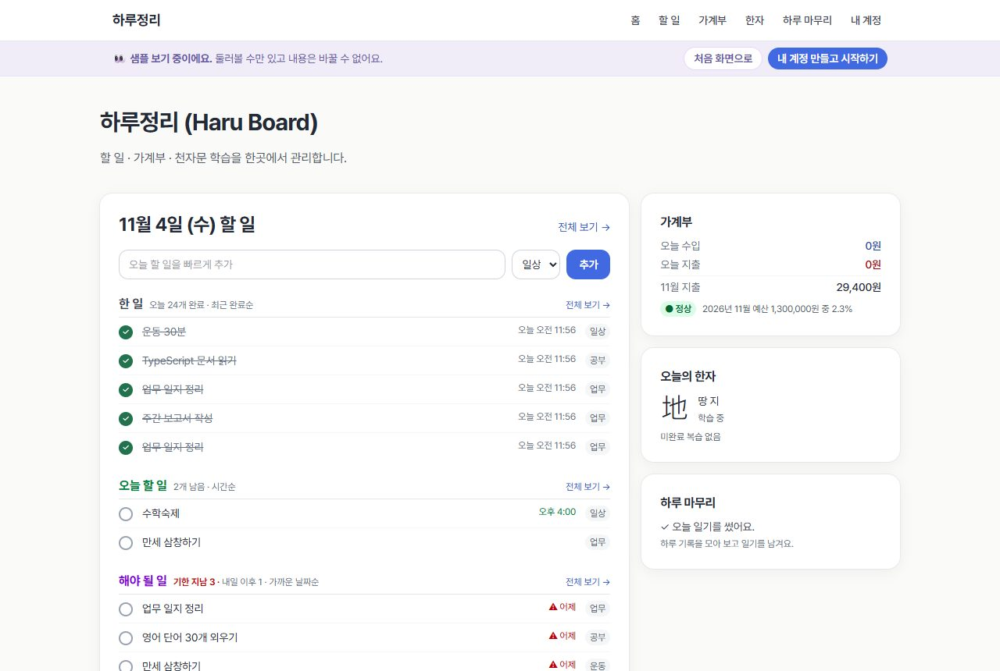</a><br><sub>홈 — 한 일·오늘 할 일·해야 될 일, 요약 카드</sub></td></tr>
<tr><td width="50%"><a href="docs/screenshots/03-todos-today.jpg">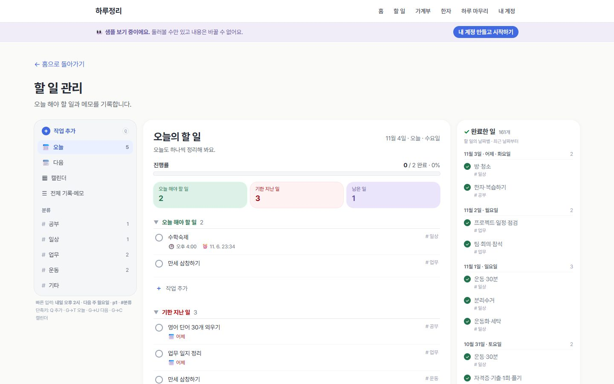</a><br><sub>할 일 — 오늘의 할 일·진행률, 오른쪽 완료한 일</sub></td><td width="50%"><a href="docs/screenshots/04-todos-detail.jpg">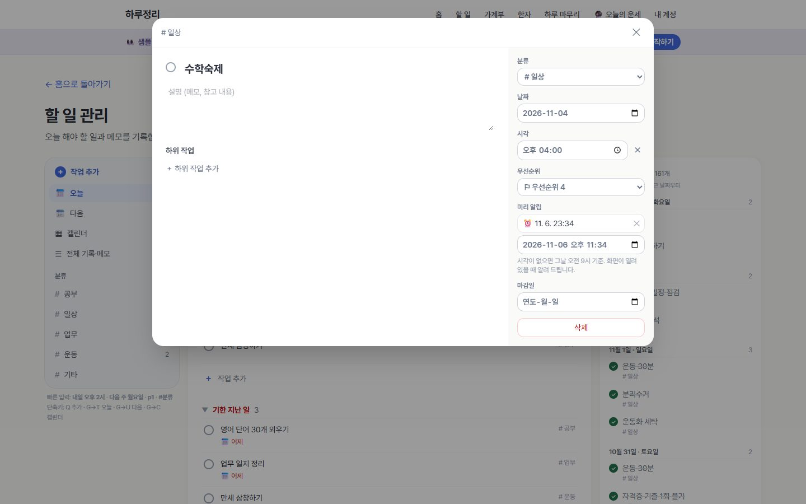</a><br><sub>할 일 상세 — 날짜·시각·우선순위·미리 알림·하위 작업</sub></td></tr>
<tr><td width="50%"><a href="docs/screenshots/05-todos-calendar.jpg">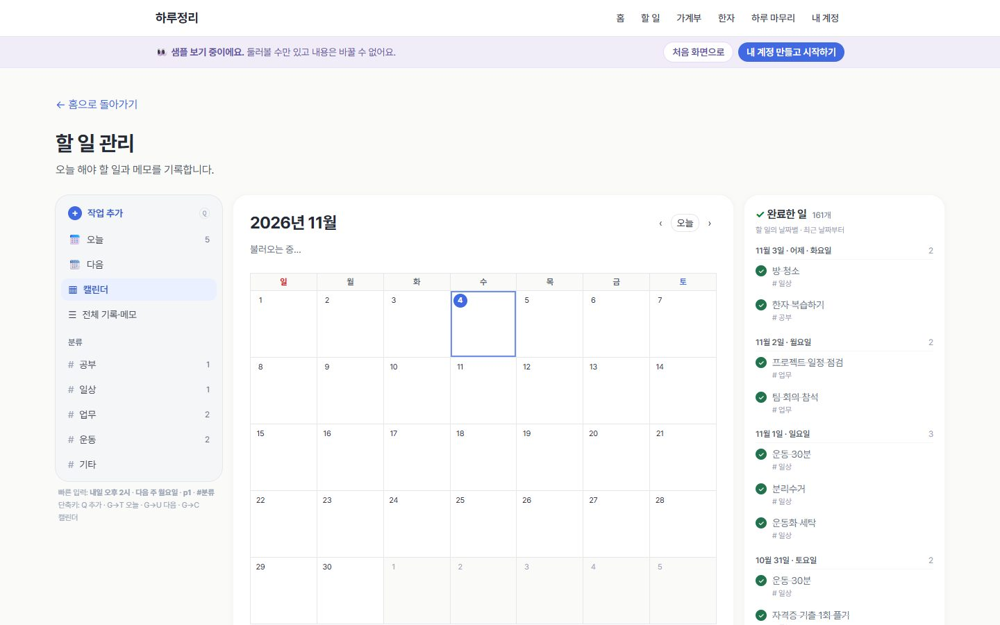</a><br><sub>할 일 — 월간 캘린더</sub></td><td width="50%"><a href="docs/screenshots/06-ledger.jpg">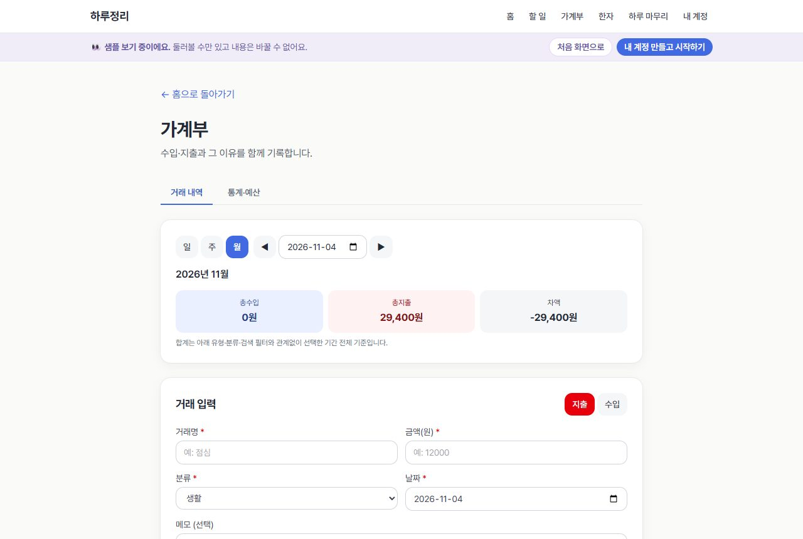</a><br><sub>가계부 — 거래 입력·기간별 합계</sub></td></tr>
<tr><td width="50%"><a href="docs/screenshots/07-ledger-stats.jpg">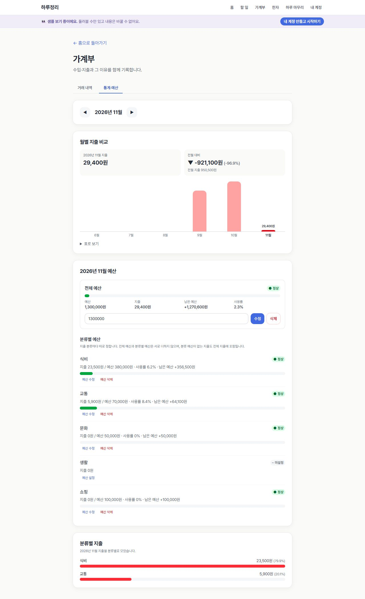</a><br><sub>가계부 — 월별 지출·예산 사용률·분류별 지출</sub></td><td width="50%"><a href="docs/screenshots/08-hanja.jpg">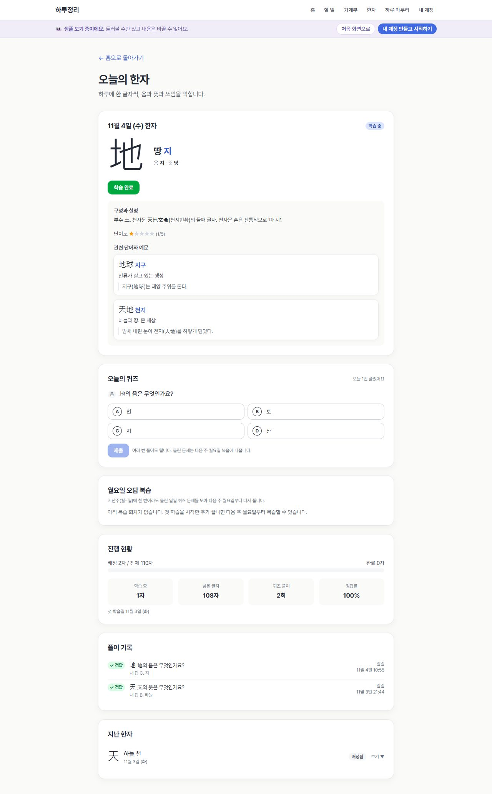</a><br><sub>한자 — 오늘의 한자·퀴즈·진행 현황</sub></td></tr>
<tr><td width="50%"><a href="docs/screenshots/09-daily.jpg">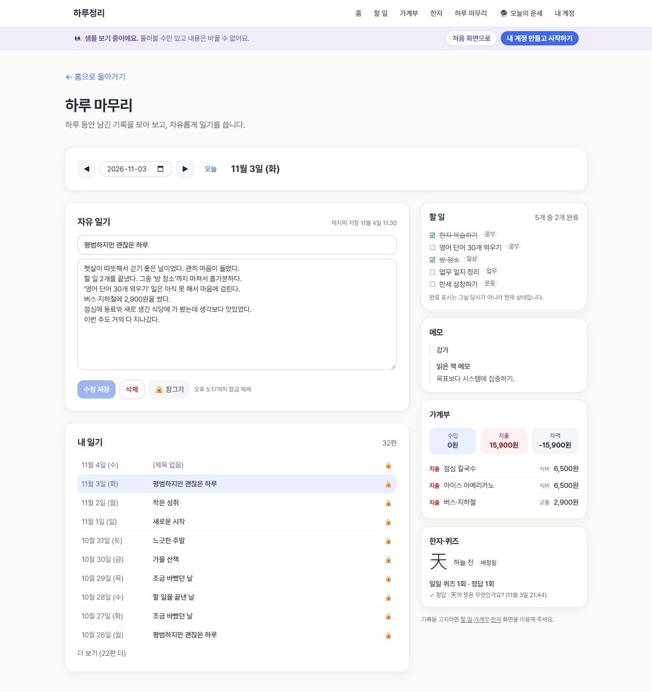</a><br><sub>하루 마무리 — 일기(비밀번호 확인 후 열림)·내 일기 목록·그날의 기록</sub></td><td width="50%"><a href="docs/screenshots/10-mobile-home.jpg">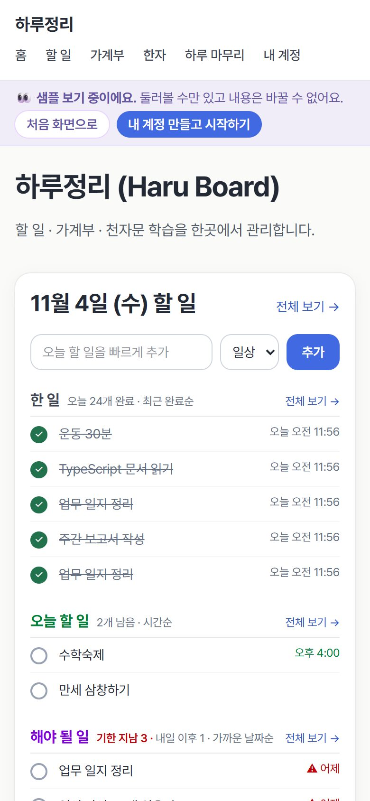</a><br><sub>모바일 — 홈</sub></td></tr>
<tr><td width="50%"><a href="docs/screenshots/11-mobile-todos.jpg">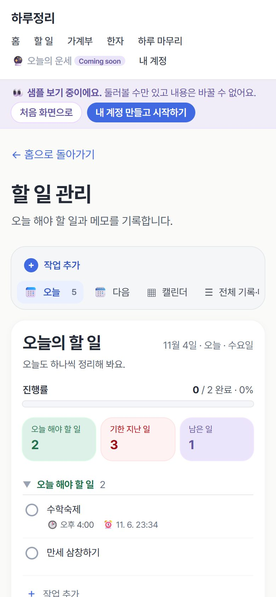</a><br><sub>모바일 — 할 일</sub></td><td></td></tr>
</table>

## 구현 상태

### 구현 완료

| 기능 | 내용 |
|---|---|
| 인증 | 회원가입(닉네임 선택), 로그인, 로그아웃, 비밀번호 재설정 요청·새 비밀번호 설정 화면, 로그인하지 않으면 개인 화면 접근 차단 |
| 할 일·메모 | 작성·조회·수정·삭제, 할 일 완료 체크, 분류 추가·이름 변경·삭제(사용 중이면 삭제 불가), 날짜·유형·완료·마감·검색 필터('전체 기록·메모' 보기) |
| 할 일 화면 (작업 관리형) | 사이드바(오늘·다음·캘린더·전체 기록·분류별 개수), **빠른 추가 자연어 인식**(오늘/내일/모레/요일/다음 주 월요일/11월 10일, 오전·오후 N시·14:00, p1~p4, #분류 — 한글 조사 처리, 인식한 말 강조·칩 표시·×로 취소, 없는 #분류는 새로 만들기, 한글 조합 중 Enter 제출 방지, 연속 입력), 오늘 보기(오늘 해야 할 일 → 기한 지난 일 → 남은 일, 요약 숫자·5개 미리보기), 오른쪽 **완료한 일** 패널(할 일 날짜별·최근 날짜부터, 누르면 상세, 체크로 완료 취소, 좁은 화면에서는 목록 아래·접기), 다음 보기(주간 날짜 띠, 빈 날 포함 날짜별 그룹, 그룹마다 작업 추가), 월간 캘린더, 작업 상세 모달(제목·설명·분류·날짜·시각·우선순위·미리 알림·마감일·삭제, 하위 작업 n/m), 완료 시 '실행 취소' 토스트, 우선순위 색 체크 원, 보기·열린 작업은 주소에 남아 새로고침해도 유지, 단축키(Q, G→T/U/C) |
| 가계부 | 수입·지출 작성·조회·수정·삭제, 수입/지출 분류 구분과 새 분류 재사용, 일/주(월~일)/월 목록과 총수입·총지출·차액 |
| 예산·통계 | 월 전체 예산, 지출 분류별 예산, 사용률과 상태(정상 / 주의 80%↑ / 한도 도달 100% / 초과), 최근 6개월 지출 비교, 전월 대비 증감(전월 지출 0이면 비교 불가), 분류별 지출 |
| 한자 | 서울 날짜 기준 하루 한 글자 배정(재접속해도 같은 글자, 중복 배정 없음, 준비된 한자 소진 안내), 학습 상태(배정 → 학습 중 → 완료), 음·뜻·구성 설명·난이도·관련 단어·예문, 진행 현황 |
| 퀴즈 | 오늘 한자의 4지선다 문제, 정답은 서버만 보관·채점, 반복 풀이, 같은 요청의 재전송 중복 방지(`request_id`), 풀이 기록 |
| 주간 오답 복습 | 끝난 주의 오답을 모아 다음 주 월요일 회차 생성(빠진 과거 회차도 생성), 문제 중복 제거, 한 문제 한 번 제출, 진행률·정답률 |
| 하루 마무리 | 날짜를 골라 할 일 → 메모 → 가계부 → 한자·퀴즈를 원본에서 모아 보기, 날짜별 자유 일기(제목 선택) 저장·수정·삭제, 내 일기 목록(날짜·제목, 최근순), 일기 본문은 로그인 비밀번호를 한 번 더 입력해야 열림(확인 후 10분 유지, 직접 잠그기) |
| 오늘의 운세 `/fortune` | 생년월일(이 기기에만 저장)로 띠·별자리를 정하고 '생년월일 + 오늘 날짜'로 미리 쓴 한국어 문장을 골라 총운·애정·재물·일·학업·건강 별점과 행운의 색·숫자·방향·물건, 오늘의 한마디를 보여 줌. 같은 날 같은 사람은 같은 운세, 다음 날 새 운세. 외부 API·DB 없이 동작, '재미로 보는 운세'로 표시. 홈 오른쪽 칸에 요약 |
| 소개(로그인 전 홈) | 히어로(‘오늘 하루를, 더 가볍게.’, 무료로 시작하기·앱 미리보기, 실제 화면을 본뜬 목업), 기능 카드 4개(각각 작은 화면 조각), 로그인 없이 눌러 보는 데모 할 일 목록(저장 안 됨, 진행률 표시), 마지막 안내, 바닥글 |
| 홈 | 제목 옆 **오늘의 글귀**(동서양 명언 968개·144명/출처, 논어·맹자·도덕경·명심보감·채근담·법구경·성경·피르케이 아보트·그리스로마 고전·셰익스피어 등 원전에서 직접 옮김, 예수님·부처님 포함, 로그인할 때마다 바뀌고 '다른 글귀'로 바로 바꿀 수 있음), 할 일 카드(가장 큰 영역)를 한 일(최근 완료순)·오늘 할 일(시간순)·해야 될 일(기한 지남+내일 이후, 가까운 날짜순) 세 칸으로 나눠 각 5개씩 표시, 칸마다 전체 보기, 빠른 추가, 가계부·예산·한자·복습·일기 요약 카드 |

### 개발하지 않은 것 / 후속 계획

- 한자는 **3,000자**를 준비했습니다(하루 한 자씩 배정).
  - 순서: 천자문 1,000자 → 한문 교육용 기초 한자 중 천자문에 없는 1,031자(중학교용 → 고등학교용) → 자주 쓰이는 한자 969자(KS X 1001 수록, Unicode Unihan 학년 등급·핵심 한자 순)
  - 훈: [위키낱말사전](https://ko.wiktionary.org/) '부록:한문 교육용 기초 한자 1800'과 각 한자 문서(CC BY-SA 4.0). 문서가 없는 천자문 63자는 전통 천자문 훈으로 작성
  - 음: 3,000자 모두 Unicode Unihan(kHangul)과 대조해 확인. 천자문 원문과 구절 풀이는 [위키문헌 '번역:천자문'](https://ko.wikisource.org/wiki/번역:천자문)(CC BY-SA 4.0)
  - 대표 단어·예문은 처음 110자에만 있고, 111번째부터는 훈음·설명·퀴즈 1문제만 있습니다. 자주 쓰이는 한자 969자의 훈은 사전 기본형(예: '긷다')으로 표기돼 있습니다.
- 퀴즈는 한자당 1문제이고 보기 순서는 고정입니다. 여러 문제와 보기 섞기는 후속 과제입니다.
- 복습에서 다시 틀린 문제를 다음 주로 자동으로 넘기는 기능은 없습니다(PRD상 후속 확장).
- 할 일의 '완료한 시각' 이력은 저장하지 않습니다. 과거 날짜를 봐도 현재 완료 상태가 표시됩니다.
- 할 일 화면의 라벨(@), 반복 일정('매일'), 댓글·첨부, 보드 레이아웃, 드래그로 순서·날짜 바꾸기, 검색 모달, 완료 기록(보고) 화면은 후속 과제입니다. 입력창의 `@라벨`과 `매일`은 지금은 제목에 그대로 남습니다.
- 커스텀 SMTP(외부 이메일 발송), 다크 모드, 데이터 내보내기는 구현하지 않았습니다.
- AI 기능(요약·추천 등)은 과제 환경에서 AI API 키가 제공되지 않아 넣지 않았습니다. 구글 로그인은 선택 사항이라 이메일·비밀번호 로그인만 제공합니다.

## 기술 스택

| 영역 | 사용 기술 |
|---|---|
| 프런트엔드·API | Next.js 16 (App Router, Route Handlers), React 19, TypeScript, Tailwind CSS 4 |
| 인증·DB | Supabase Auth, PostgreSQL (RLS), `@supabase/ssr`, `@supabase/supabase-js` |
| 배포 | Vercel (GitHub `master` 푸시 시 자동 배포), Supabase (Sydney 리전) |
| 디자인 | 디자인 명세(Clean Minimal + Soft Emotional) 토큰을 `app/globals.css`에 정의: 따뜻한 흰 바탕 `#FAFAF8`, 본문 `#242936`, 주요 동작 `#4169E1`, 블러시·라벤더·민트 보조색, 모서리 12/16/24px, 옅은 그림자, Pretendard 글꼴, 키보드 초점 테두리, 120~240ms 전환, `prefers-reduced-motion` 존중 |

## 개발 방식 (바이브코딩)

AI 코딩 에이전트 **Claude Code**(VS Code 확장)와 대화하며 기획부터 배포까지 진행했습니다.

**진행 순서**

1. **PRD 먼저 작성:** [PRD.md](PRD.md)(v1.3)에 문제·사용자·기능·화면·DB·API를 정리하고, 이 문서를 기준으로 개발했습니다. 개발 중 새로 확정한 규칙은 PRD 맨 아래 'v1.4 추가 확정 규칙'에 기록했습니다.
2. **첫 배포를 먼저:** Next.js 기본 화면 → GitHub → Vercel 배포를 확인한 뒤 Supabase 인증·DB를 붙였습니다.
3. **기능 단위로 구현:** 할 일·메모 → 가계부 → 예산·통계 → 한자 → 퀴즈·주간 복습 → 하루 마무리·홈 순서로 만들었습니다. 기능마다 실제 DB와 배포 주소에서 테스트한 뒤 다음으로 넘어갔습니다.
4. **사용자 문서로 개선:** 직접 쓴 'UI·기능 명세서'(할 일 화면 개편)와 '디자인 명세'(색·글꼴·소개 화면)를 에이전트가 읽고 반영했습니다.

**에이전트에게 준 규칙**

- **DB 변경:** 모든 변경은 마이그레이션 파일로 관리했습니다. 적용 전 대상·영향을 보고받고 승인한 뒤에만 반영했습니다(마이그레이션 7개).
- **비밀 정보:** 비밀 키·DB 비밀번호는 코드와 GitHub에 올리지 않았습니다. 브라우저에는 공개 키만 둡니다.
- **기존 코드 보호:** `AGENTS.md`의 Next.js 16 안내(한국어 번역)를 지키고, 기존 코드·커밋을 덮어쓰지 않았습니다.
- **정직한 보고:** 테스트 실패나 미구현 부분은 그대로 보고하고 README에 적었습니다.

**사용한 도구**

| 도구 | 쓴 곳 |
|---|---|
| Claude Code (에이전트) | 기획 정리, 코드 작성, 테스트 작성·실행, 커밋·배포 |
| Skill: `docx` | Word로 받은 '할 일 관리 웹앱 UI·기능 명세서' 읽기 |
| Skill: `dataviz` | 가계부 통계 그래프 설계(한 축, 색 대비, '표로 보기' 제공) |
| Supabase CLI | 마이그레이션 적용·이력 확인 (`db push`, `migration list`) |
| PGlite | 내 컴퓨터에서 마이그레이션을 실제와 같은 PostgreSQL로 적용해 RLS·권한·트리거 검사 |
| Playwright | 실제 브라우저로 화면 흐름 검사, README 화면 캡처 |
| Vercel·GitHub | `master` 푸시 시 자동 배포 |

- 서비스 기능 안에 MCP나 AI API를 연결하지는 않았습니다(아래 '개발하지 않은 것' 참고).

## 구조와 보안 설계

- **DB 17개 테이블, 모두 RLS 사용.** 기본 권한을 회수한 뒤 필요한 열에만 권한을 줍니다. 예를 들어 퀴즈 문제 테이블은 정답·해설 열을 사용자가 읽을 수 없습니다.
- **샘플 계정은 DB가 보기 전용으로 강제합니다.** 공개된 샘플 계정(`app_private.read_only_users`)이 로그인했을 때, 사용자 데이터 테이블 12개의 쓰기 트리거가 추가·수정·삭제를 거부합니다(한자 배정·퀴즈 제출처럼 `SECURITY DEFINER` 함수 안의 쓰기 포함). `auth.users` 트리거가 이 계정의 비밀번호·이메일 변경도 거부합니다. 다른 사용자, 가입, 관리자 작업에는 영향이 없습니다.
- **일기 본문 잠금은 DB가 강제합니다.** `daily_reviews.content` 열은 사용자에게 SELECT 권한이 없어 API나 브라우저에서 직접 읽을 수 없습니다. 본문은 `read_diary` 함수로만 읽히며, 함수가 로그인 토큰(JWT `amr`)의 비밀번호 확인 시각이 10분 이내인지 검사합니다. 화면의 비밀번호 확인은 같은 이메일로 다시 로그인해 이 시각을 새로 만드는 방식입니다(토큰을 갱신해도 시각은 바뀌지 않음).
- **소유권은 DB가 강제합니다.**
  - 거래와 분류는 `(user_id, category_id, type)` 복합 FK로 묶어, 다른 사람의 분류나 유형이 다른 분류를 쓸 수 없습니다.
  - 분류별 예산은 지출 분류만 허용합니다(`category_type='expense'` + 복합 FK).
  - 거래나 예산이 사용 중인 분류는 삭제할 수 없습니다(409).
- **여러 단계를 한 번에 처리해야 하는 작업은 PostgreSQL 함수 안에서 한 트랜잭션으로 처리합니다.**
  - 대상: 오늘의 한자 배정, 퀴즈 채점·기록, 복습 회차 생성, 복습 제출·완료 처리
  - 권한이 필요한 함수는 외부에 노출되지 않는 `app_private` 스키마에 `SECURITY DEFINER`로 둡니다. 공개 스키마에는 호출만 넘겨 주는 `SECURITY INVOKER` 래퍼만 둡니다.
  - 모든 함수는 `search_path=''`이고 실행 권한은 로그인 사용자에게만 있습니다. 함수 안에서 `auth.uid()`로 소유권을 다시 확인합니다.
  - 동시 요청은 advisory lock과 행 잠금으로 막습니다.
- **가입 시 프로필과 기본 분류는 DB 트리거가 만듭니다.**
- **API는 모두 서버에서 로그인 사용자를 확인합니다.** 응답 형식은 `{ success, data }` / `{ success, error: { code, message } }`로 통일했습니다.
- 브라우저에는 Supabase URL과 공개(publishable) 키만 전달합니다. 서비스 역할 키는 쓰지 않습니다.

DB 변경은 모두 [supabase/migrations](supabase/migrations)의 마이그레이션 파일로 관리합니다.

| 파일 | 내용 |
|---|---|
| `20261103120000_init_schema.sql` | 테이블, 제약, 트리거, 인덱스, RLS, 권한 |
| `20261103120100_atomic_functions.sql` | 원자적 처리 함수와 래퍼 |
| `20261103120200_seed_hanja_initial_10.sql` | 초기 한자 10자, 단어, 예문, 문제 (다시 실행해도 중복되지 않음) |
| `20261103130000_entries_time_priority_reminder_subtask.sql` | 할 일 시각·우선순위(1~4)·미리 알림·하위 작업(같은 사용자만 참조하는 복합 FK, 부모 삭제 시 함께 삭제) |
| `20261104120000_seed_hanja_chars_11_110.sql` | 천자문 11~110번째 한자 100자, 대표 단어·예문 100개, 문제 100개 (다시 실행해도 중복되지 않음) |
| `20261104130000_daily_reviews_title_locked_content.sql` | 일기 제목(선택, 100자), 일기 본문 직접 조회 권한 회수, 비밀번호 재확인 10분 이내에만 본문을 돌려주는 `read_diary` 함수 |
| `20261104140000_read_only_sample_account.sql` | 보기 전용 샘플 계정: 쓰기 차단 트리거(데이터 테이블 12개), 샘플 계정 비밀번호·이메일 변경 차단, `is_read_only()` |
| `20261104150000_seed_hanja_chars_111_3000.sql` | 한자 111~3,000번째 2,890자(천자문 나머지 → 교육용 기초 한자 → 자주 쓰이는 한자), 한자마다 문제 1개 |

## 주요 API

| 영역 | 경로 |
|---|---|
| 할 일·메모 | `/api/entries`, `/api/entries/{id}`, `/api/entry-categories`, `/api/entry-categories/{id}` |
| 가계부 | `/api/transactions`, `/api/transactions/{id}`, `/api/transactions/summary`, `/api/transactions/stats`, `/api/transaction-categories`, `/api/transaction-categories/{id}` |
| 예산 | `/api/budgets`, `/api/budgets/{month}`, `/api/budgets/{month}/categories/{category_id}`, `/api/budgets/{month}/summary` |
| 한자 | `/api/hanja/today`, `/api/hanja/today/assign`, `/api/hanja/learning`, `/api/hanja/learning/{id}`, `/api/hanja/{id}`, `/api/hanja/progress` |
| 퀴즈 | `/api/hanja/quizzes/today`, `/api/hanja/quizzes/attempts` |
| 복습 | `/api/hanja/reviews`, `/api/hanja/reviews/prepare`, `/api/hanja/reviews/{id}`, `/api/hanja/reviews/{id}/items/{item_id}/answer`, `/api/hanja/reviews/{id}/summary` |
| 하루 마무리·홈 | `/api/daily-summary`, `/api/daily-reviews`(날짜·제목), `/api/daily-reviews/list`(내 일기 목록), `/api/daily-reviews/content`(본문, 비밀번호 재확인 10분 이내만, 아니면 403 `REAUTH_REQUIRED`), `/api/dashboard` (홈과 하루 요약 GET은 조회만 하며 한자 배정·복습 생성을 하지 않음) |

`/api/entries` 목록은 할 일 화면용으로 `from`·`to`(날짜 범위), `parent_id`·`top_level`(하위 작업), `remind_from`·`remind_to`(알림), `sort=schedule`(날짜→시각→우선순위), `with_subtasks=true`(하위 작업 수) 옵션을 더 받습니다.

자세한 요청·응답 규칙은 [PRD.md](PRD.md) 8장을 따릅니다. PRD 표에 없는 `/api/hanja/learning`(지난 한자 목록)과 `/api/transactions/stats`(통계 탭)는 화면에 필요해서 추가했습니다.

## 검증

실제 Supabase DB에 테스트 계정 A·B 두 개를 만들어 API 단위로 확인했고, 주요 화면은 브라우저로 직접 확인했습니다. 테스트 계정 정보와 테스트 스크립트는 공개 저장소에 올리지 않았습니다.

| 영역 | 확인한 내용 | 결과 |
|---|---|---|
| DB 권한 | PGlite에 마이그레이션을 적용해 RLS, 열 권한, 함수 실행 권한, 우회 시도, `search_path` 가로채기를 확인 | 87개 통과 |
| 할 일·메모 | CRUD, 필터·검색, 분류 중복·사용 중 삭제, 다른 사용자 차단 | 39개 통과 |
| 할 일 화면 개편 | DB(PGlite 16 + 실제 DB 7): 새 열 권한·제약, 다른 사용자 할 일을 부모로 지정 차단, 부모 삭제 시 하위 작업 삭제 / API 36: 시각·우선순위·알림 검증, 하위 작업 한 단계 규칙, 범위·정렬·하위 작업 수 / 입력 해석기 42: 명세 예문, 요일·주 계산, 조사 제거, 잘못된 날짜 / 브라우저 18: 칩 표시, 저장 결과, 한글 조합 중 Enter, 빈 날 그룹, 새로고침 유지, 하위 작업 0/1, 완료·실행 취소, 캘린더, 오늘 보기 묶음 순서 / 완료한 일 패널 13: 위치, 날짜 묶음 순서·개수, 완료하면 나타남, 상세 열기, 완료 취소 후 목록 복귀, 좁은 화면 | 모두 통과 |
| 가계부 | 금액 검증, 유형 불일치 차단, 주·월 경계, 합계와 필터 독립 | 43개 통과 |
| 예산·통계 | 79.998%=정상 / 80%=주의 / 100%=한도 도달 / 초과, 예산 삭제 시 거래 보존 | 62개 통과 |
| 한자 | 동시 배정 요청에도 1건, 상태 전환 순서, 직접 쓰기 차단 | 41개 통과 |
| 퀴즈 | 정답 비공개, 서버 채점, `request_id` 중복 방지(동시 요청 포함), 정답 열 직접 조회 차단 | 45개 통과 |
| 주간 복습 | 관리자 시드로 지난주 오답을 만든 뒤 회차 생성, 중복 제거, 주 경계, 원자적 제출, 동시 제출, 다른 사용자 차단 | 27개 통과 |
| 하루 마무리·홈 | 할 일 집합 규칙, GET 조회 전용, 일기 UPSERT·삭제, 사용자 분리 | 51개 통과 |
| 한자 3,000자 | 생성 단계: 3,000자 모두 Unihan 음과 대조, 훈 형식 검사, 간체자·이체자 제외 / DB(PGlite 14): 3,000자·3,000문제, 정답 보기 일치, 순서 연속, 재실행 중복 없음, 110자를 끝낸 사용자의 다음 배정 = 111번째 / 배포: 진행 현황 3,000자, 한자 37·퀴즈 45 재통과 | 모두 통과 |
| 샘플(보기 전용) | DB(PGlite 31): 샘플 계정 쓰기 거부(직접·함수 안), 비밀번호·이메일 변경 거부, 다른 사용자·가입·관리자 작업 정상 / 실제 연동 24: 앱 API·DB 직접 요청 모두 403, 원래 비밀번호 유지, 테스트 계정은 정상 / 브라우저 13: 샘플 확인 → 홈·안내 띠, 쓰기 시 안내, 일기 열기, 내 계정 만들기 | 모두 통과 |
| 일기 제목·잠금 | DB(PGlite 20): 본문 직접 조회 거부, 비밀번호 확인 30초·9분 전 허용 / 11분 전·확인 없음 거부, 다른 사용자 차단 / API 17 + 만료 3: 응답·목록·요약에 본문 없음, PostgREST 직접 조회 거부, 실제로 11분 지난 세션 403 / 브라우저 16: 잠긴 화면, 틀린·맞는 비밀번호, 목록 선택, 잠그기 | 모두 통과 |

- 각 기능은 Vercel 배포 주소에서도 같은 테스트로 다시 확인했습니다.
- 주간 복습은 이미 푼 회차의 재전송·중복 처리만 배포 주소에서 확인했습니다. 첫 제출부터의 전체 흐름은 로컬 서버와 실제 DB로 확인했습니다.
- 복습 검증용 관리자 시드: [supabase/tests/weekly_review_test_seed.sql](supabase/tests/weekly_review_test_seed.sql)

## 제한 사항

- **비밀번호 재설정 메일:** Supabase 기본 SMTP를 사용합니다. 기본 SMTP는 프로젝트 팀원 이메일 외의 주소로는 메일을 보내지 않고, 발송 횟수 제한도 매우 낮습니다. 그래서 일반 사용자는 재설정 메일을 받지 못할 수 있습니다. 재설정 요청 화면과 메일 링크로 들어오는 새 비밀번호 설정 화면은 구현되어 있습니다. 외부 발송을 하려면 커스텀 SMTP 설정이 필요합니다.
- **이메일 확인 비활성화:** 평가 편의를 위해 Supabase의 Confirm Email을 꺼 두었습니다. 실제 운영 전에는 다시 켜야 합니다.
- **유출 비밀번호 검사:** Supabase Security Advisor에 'Leaked Password Protection 비활성' 경고 1건이 남아 있습니다. 현재 무료 플랜 프로젝트에서는 켜지 않은 상태입니다.
- **날짜 기준:** 모든 '오늘'과 주(월~일) 계산은 한국 시간(Asia/Seoul) 기준입니다. 할 일 화면의 주간 날짜 띠와 캘린더는 일~토로 표시합니다.
- **미리 알림:** 하루정리 화면(어느 페이지든)이 열려 있을 때만 브라우저 알림과 화면 배너로 알려 줍니다. 앱을 닫아 두면 알림이 오지 않습니다(서버 푸시 미구현). 브라우저 알림은 처음 알림을 설정할 때 권한을 허용해야 표시됩니다.
- **복습 회차 생성 시점:** 회차는 한자 화면에 들어갈 때 만들어집니다. 홈 화면은 조회만 하므로 미완료 복습 수에는 이미 만들어진 회차만 포함됩니다.

## 로컬에서 실행하기

```bash
npm install
cp .env.example .env.local   # Windows PowerShell: Copy-Item .env.example .env.local
npm run dev                   # http://localhost:3000
```

`.env.local`에는 Supabase 대시보드 → Project Settings → API의 값을 넣습니다.

```
NEXT_PUBLIC_SUPABASE_URL=https://<project-ref>.supabase.co
NEXT_PUBLIC_SUPABASE_ANON_KEY=<publishable 키>
```

- 공개(publishable) 키만 사용합니다. `service_role`·secret 키나 DB 비밀번호는 넣지 말고, `.env.local`은 커밋하지 않습니다(`.gitignore`에 포함).
- 새 Supabase 프로젝트에 DB를 만들려면 Supabase CLI로 연결한 뒤 마이그레이션을 적용합니다.

  ```bash
  npx supabase@2.58.5 login
  npx supabase@2.58.5 link --project-ref <project-ref>
  npx supabase@2.58.5 db push
  ```

- 평가용 환경과 같이 쓰려면 Supabase 대시보드의 Authentication 설정을 다음과 같이 맞춥니다.
  - **Sign In / Providers → Email:** Confirm email 끄기
  - **URL Configuration → Site URL:** 배포 주소 (예: `https://haru-board-navy.vercel.app`)
  - **URL Configuration → Redirect URLs:** `https://<배포 주소>/**`, `http://localhost:3000/**`
  - 비밀번호 재설정 링크는 `/auth/callback?next=/reset-password`로 돌아오므로, 주소 뒤에 `/**`를 붙여 하위 경로와 쿼리까지 허용합니다.

| 명령 | 용도 |
|---|---|
| `npm run dev` | 개발 서버 |
| `npm run build` / `npm start` | 프로덕션 빌드와 실행 |
| `npm run lint` | ESLint |
